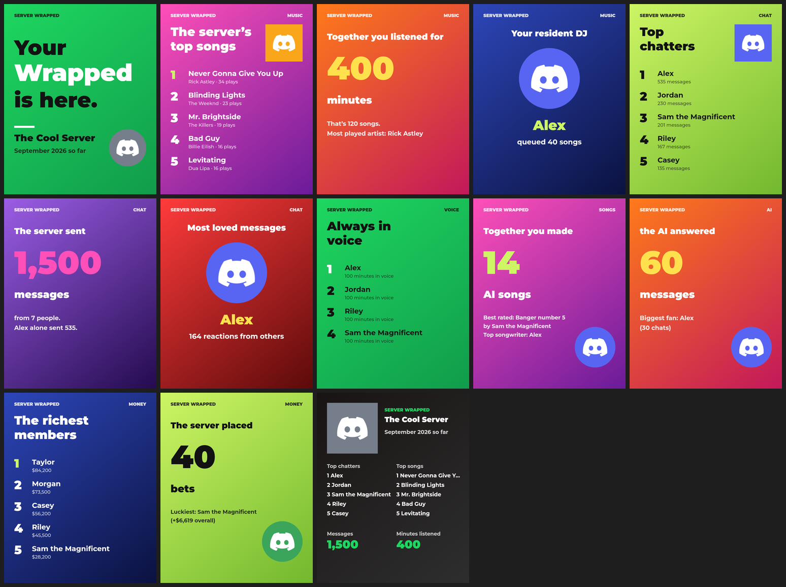
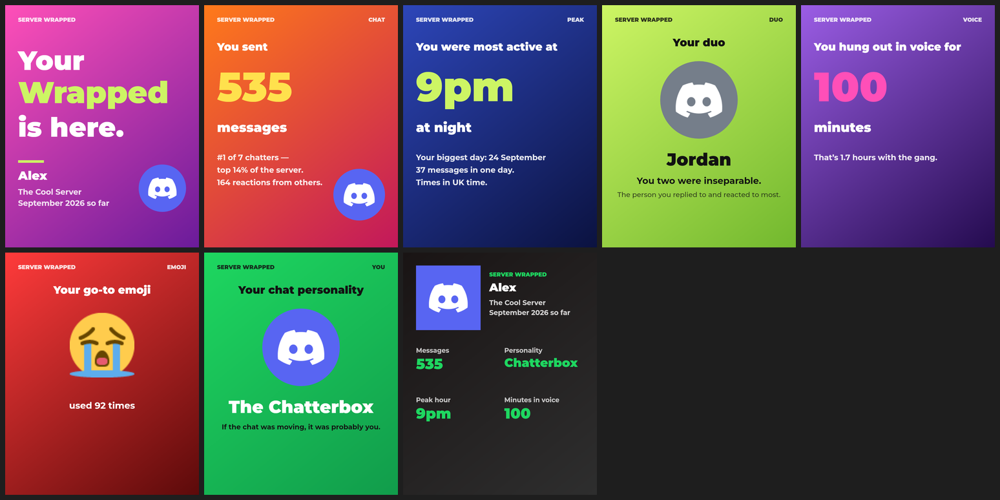

# Discord Server Wrapped module

A **Spotify Wrapped-style recap** of your Discord server — picture slides of the month's top chatters, most loved messages, time in voice and more, plus a personal Wrapped for everyone. A drop-in module for any [discord.js](https://discord.js.org) v14 bot.





*(Preview made with test data.)*

## Commands

| Command | What it does |
|---|---|
| `!wrapped` / `/wrapped` | This server's Wrapped, this month so far |
| `!wrapped last` · `!wrapped year` | Last month · this year |
| `!wrapped @someone` | One person's Wrapped: messages, most active hour, their "duo", go-to emoji, chat personality… |
| `!wrapped autopost on` / `/wrapped-autopost` | Post last month's Wrapped in this channel on the 1st of every month (Manage Server) |

Only the person who asked can flip through the slides (with the menu under the picture).

## Sections

Counted automatically: **chat, reactions, voice, emoji, duo, peak hour, personality**.

Optional — only shown if you switch them on in the config **and** your bot reports them with one line of code: **music** (top songs, minutes listened, resident DJ), **AI songs**, **AI chatbot**, **economy** (richest members, bets). A section with nothing to show is skipped, so a server without a music bot never sees a music slide.

**Optional video add-on:** a **▶ Play as video** button that turns the slides into a short video with music (needs ffmpeg, and yt-dlp for song clips).

## Quick setup

1. Copy the `server-wrapped` folder into your bot's folder.
2. `npm install @napi-rs/canvas`
3. Turn on **Message Content Intent** in the [Discord Developer Portal](https://discord.com/developers/applications) (your bot → Bot → Privileged Gateway Intents).
4. Add one line after your client is created (with the `Guilds`, `GuildMessages`, `MessageContent`, `GuildMessageReactions` and `GuildVoiceStates` intents, and the `Message`, `Channel` and `Reaction` partials):

   ```js
   const wrapped = require('./server-wrapped')(client, require('./server-wrapped/wrapped.config.js'));
   ```
5. Set your timezone in `server-wrapped/wrapped.config.js` and restart your bot.

Stats count from the moment you add it, so the first Wrapped fills up over the month.

Full step-by-step instructions, the optional sections, the video add-on (with how to install ffmpeg and yt-dlp on Windows, Mac and Linux) and troubleshooting: **[server-wrapped/README.txt](server-wrapped/README.txt)**. There's also a tiny standalone bot to try it with: [`example-bot.js`](example-bot.js).

## Good to know

- Stats are saved in one JSON file. It only stores counts — never what anyone wrote.
- Slides are drawn with [`@napi-rs/canvas`](https://www.npmjs.com/package/@napi-rs/canvas) — works on Windows, Mac and Linux with nothing else to install.
- Font: [Montserrat](https://github.com/JulietaUla/Montserrat), under the SIL Open Font License ([server-wrapped/fonts/OFL.txt](server-wrapped/fonts/OFL.txt)).

## Requirements

- Node.js 18+
- discord.js 14.19 or newer
- `@napi-rs/canvas`
- For the video add-on only: ffmpeg (and yt-dlp for song clips)

## License

[MIT](LICENSE) — free to use, change and share, including in your own bots. The bundled Montserrat font files keep their own [SIL Open Font License](server-wrapped/fonts/OFL.txt).
